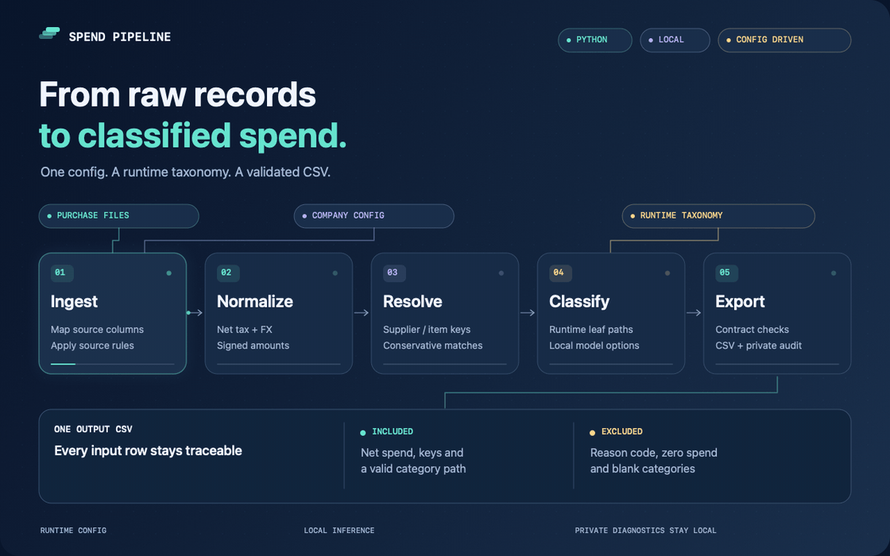
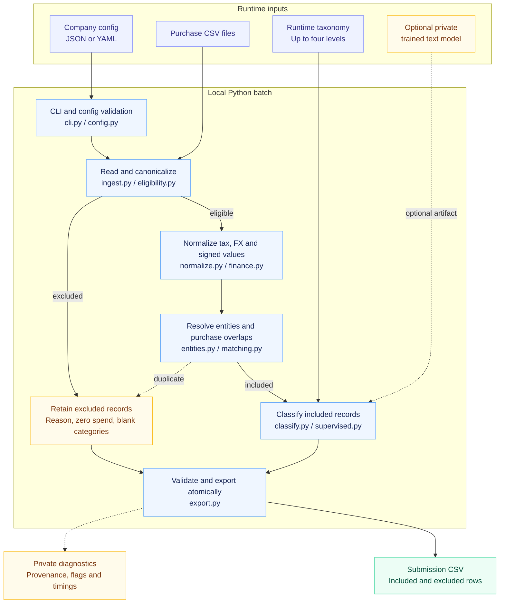
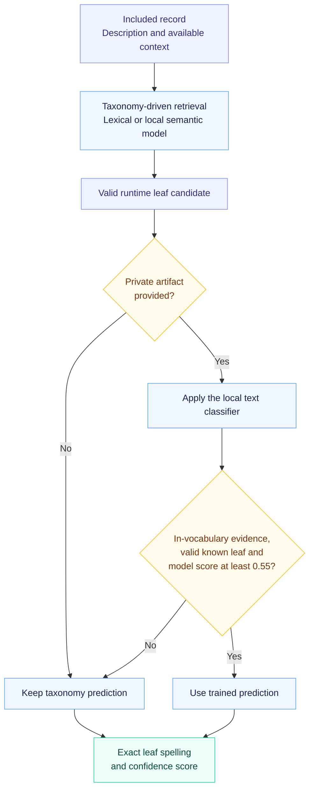

# Configurable spend pipeline

A local Python CLI turns procurement CSVs into one validated spend row per input record. Companies are described by JSON or YAML; the taxonomy is loaded at runtime. The same code supports a company with no labels and a new tree of up to four levels.

[Setup](#setup) · [Run the pipeline](#run-one-company-end-to-end) · [Validate](#verify-outputs-and-tests) · [Configuration](#configuration-and-blind-test)



*Illustrative batch flow, not a runtime recording. [View the static overview](docs/assets/pipeline-overview.png).*

## Architecture

One local batch process reads the company config and input files, then writes the submission CSV and a separate private audit trail. The diagram follows the implemented modules; the taxonomy and optional model are runtime inputs.



<details>
<summary>View the output contract</summary>

Every input record receives one output row, including exclusions:

```text
record_id,include,exclusion_reason,supplier_key,item_key,spend,l1,l2,l3,l4,confidence
```

Included rows carry net spend, entity keys and a valid leaf path. Excluded rows carry a reason code, zero spend and blank categories. A valid output schema does not establish semantic classification accuracy.

</details>

## How labels remain optional

The runtime taxonomy supplies the available paths. A private trained model can replace a prediction only when its result passes the implemented checks. A company with no labelled examples uses the taxonomy route directly.



Confidence scores are uncalibrated. The fallback keeps outputs within the runtime tree; it does not guarantee that the selected category is correct. These diagrams use [GitHub's Mermaid rendering](https://docs.github.com/en/get-started/writing-on-github/working-with-advanced-formatting/creating-diagrams).

## Setup

Python 3.11 is the model-enabled reference environment. Python 3.10+ can run the standard-library lexical pipeline with JSON configs.

```bash
python3.11 -m venv .venv
source .venv/bin/activate
python -m pip install -e .
python -m pip install -r requirements-ml.txt
```

For YAML only, also install `requirements-yaml.txt`. Optional ML dependencies are pinned to the versions used for verification. Install the general-purpose model once, before offline inference:

```bash
python -c "from sentence_transformers import SentenceTransformer; SentenceTransformer('sentence-transformers/LaBSE', revision='836121a0533e5664b21c7aacc5d22951f2b8b25b', device='cpu', trust_remote_code=False)"
```

Inference reads local model assets only. There is no paid API, key, or external transmission of purchase text. API cost per 1,000 lines is **0**. Model download and dependency installation are separate from measured batch runtime. The verified local environment reused installed optional packages; a fresh download/install was not timed.

## Run one company end to end

Place the authorised inputs under their original company directories. Confidential inputs and models are deliberately absent from the public repository.

```bash
python -m spend_pipeline run --config configs/A.json --input-root company_A --output submission/Ayush_Kumar__A.csv --diagnostics private/run_A.json
```

This command performs ingestion, tax/FX normalisation, eligibility, entity resolution, purchase matching, runtime-taxonomy classification, contract validation, and atomic export. It runs without labels. `configs/A.json` selects lexical retrieval; `configs/B.json` selects the stronger measured local semantic route and requires the model setup above. A config with `classifier.mode="lexical"` needs no optional ML packages; `auto` explicitly permits a logged lexical fallback. A missing model in explicit `semantic` mode fails before export.

## Reproduce the supplied-label improvements

Train private artifacts locally from the supplied labels, then pass them explicitly. These full-data fits produce submission predictions; they have no held-out accuracy claim.

```bash
python -m spend_pipeline train --config configs/A.json --input-root company_A --labels company_A/labels_A.csv --artifact private/models/A_full.pkl --all-labels
python -m spend_pipeline train --config configs/B.json --input-root company_B --labels company_B/seed_labels.csv --label-id-column line_id --artifact private/models/B_full.pkl --all-labels
python -m spend_pipeline run --config configs/A.json --input-root company_A --artifact private/models/A_full.pkl --output submission/Ayush_Kumar__A.csv --diagnostics private/final/A.json
python -m spend_pipeline run --config configs/B.json --input-root company_B --artifact private/models/B_full.pkl --output submission/Ayush_Kumar__B.csv --diagnostics private/final/B.json
```

Only load artifacts you trained locally. Their vocabulary and coefficients are confidential and ignored by Git. Omit `--artifact` for the genuine zero-label route. An explicitly requested missing artifact fails rather than silently changing the method.

## Verify outputs and tests

```bash
python -m spend_pipeline validate --config configs/A.json --input-root company_A --output submission/Ayush_Kumar__A.csv
python -m spend_pipeline validate --config configs/B.json --input-root company_B --output submission/Ayush_Kumar__B.csv
python -m unittest discover -s tests -v
```

Validation checks exact record coverage, schema/order, leaf paths, finite values and reason consistency, then replays financial, inclusion and matching rules to detect altered finite amounts or grouping keys. It validates category membership, not whether a category is semantically correct. Model-dependent tests skip in the minimal environment; the reported complete suite uses the ML environment.

Independent evaluation commands:

```bash
python -m evaluation.adversarial --output private/my_adversarial_review
python -m evaluation.hidden --output private/my_synthetic_review --seeds 170101 170203 170307 --classifier-mode semantic --python .venv/bin/python
python -m spend_pipeline evaluate --prediction submission/Ayush_Kumar__A.csv --labels company_A/labels_A.csv --raw company_A/erp_goods_receipts.csv --output private/my_A_score.json
```

The last command scores saved predictions after output exists. Scoring the final artifact-assisted outputs on their own training labels is an in-sample diagnostic and must not be presented as generalisation. Published development comparisons use models trained only on pre-reserved groups.

See [REVIEW.md](REVIEW.md) and [evaluation_results.json](evaluation_results.json) for measured results, baseline failures, fixes, runtime and limitations. Synthetic fixtures are self-authored; they do not reproduce the organisers' undisclosed test.

## Configuration and blind test

Use `configs/company_template.json` as a data-only onboarding example. Bind file/column names, number/date formats, source namespaces, explicit missing-status semantics, tax rules, optional FX table and structured non-procurement rules. Adapt its status policy to documented source semantics. A new company requires no Python, category synonyms, or manually labelled rows.

Unknown config keys, invalid settings, duplicate IDs, malformed input rows and invalid taxonomy paths fail clearly. Missing optional fields are flagged privately. Default financial policies fail on unresolved money. B has explicit estimation exceptions described in [DECISIONS.md](DECISIONS.md); validation cannot establish their unknown true values.

At the blind test, use the unchanged A/B configs with new `--input-root` directories and the already trained private artifacts. Create C's config inside `submission/`, use its runtime tree without an artifact, and generate `Ayush_Kumar__A2.csv`, `Ayush_Kumar__B2.csv`, and `Ayush_Kumar__C.csv`. Validate all three. Push only C's config and those three CSVs during the test. The build freezes on **19 November 2026 at 10:00 AM IST**; the blind-test deadline is **12:00 noon IST**. No post-freeze code, model, prompt or dependency changes.

`.gitignore` protects inputs, the confidential brief/planning files, private reports, trained models and raw CSVs. Only contracted submission CSV names are allowlisted. Git initialisation, remote publication and form submission remain separate user actions.
